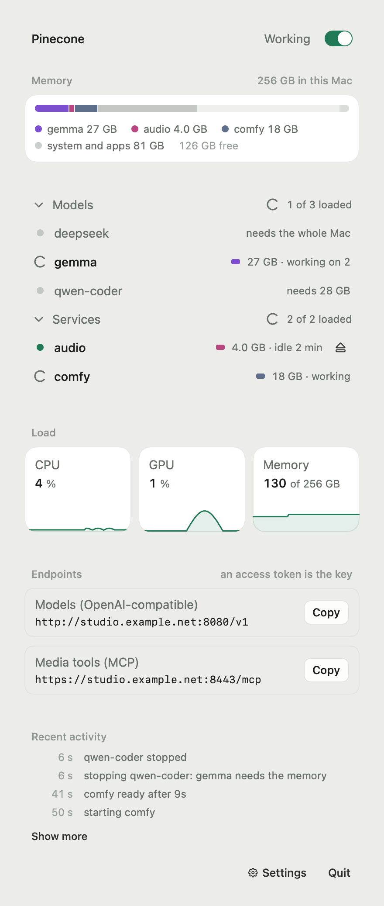

<h1 align="center">
  <picture>
    <source media="(prefers-color-scheme: dark)" srcset="docs/images/logo-dark.svg">
    
  </picture>
</h1>

Run more local AI than fits into your Mac's memory at once.

<p align="center">
  <picture>
    <source media="(prefers-color-scheme: dark)" srcset="docs/images/panel-dark.png">
    
  </picture>
</p>

### The problem

With a chat model, a coding model, an image generator and a speech model on one machine, or large models that almost take the whole vram, something is always in
the way of something else, and you end up starting and stopping servers by hand.

### What Pinecone does

- **You say what the system keeps, not what a model gets.** Everything else belongs to models, and Pinecone raises the Mac's GPU memory limit to match.
- **It loads and unloads for you.** A request for a model that is not in memory starts it. If it does not fit,
  whatever is idle goes first. A request waits while that happens; nothing that is working is ever stopped.
- **It is made for tight machines.** One large model that needs the whole Mac, or a bundle of smaller ones
  side by side, or both in turn: it never plans more than the space you gave it.
- **Services become MCP tools.** Image gen, music and speech servers are not chat models, so Pinecone wraps them into
  an MCP server that describes what they can do. A tool is a few lines in the config, not code. You give this URL to your agent and it will be able to handle all your assets.
- **Pair it with Tailscale.** Now you can safely share your inference with your other devices. Every client needs an access token, which you make in the app.

That leaves a client with two addresses, both shown in the menu bar app:

| Endpoint | For |
|---|---|
| `http://127.0.0.1:8080/v1` | Models, as an OpenAI-compatible API. The `model` in a request picks one. |
| `http://127.0.0.1:8090/mcp` | Tools, as an MCP server: make an image, edit a photo, compose music, speak, transcribe. |

These are the addresses on the Mac itself. [Clients](docs/clients.md) says how to let other devices in; the app then shows the addresses to give them.

### Start

Get the menu bar app from the **[latest release](https://github.com/pmndre/pinecone/releases/latest)**: open
`Pinecone-<version>.dmg` and drag Pinecone to Applications. It is signed and notarised, runs on Apple silicon and
Intel, and needs macOS 15.

The app shows and controls the scheduler, which is not part of it. Install the scheduler from this repository:

```bash
git clone https://github.com/pmndre/pinecone && cd pinecone
python3 -m venv .venv && .venv/bin/pip install -r requirements.txt
.venv/bin/python scheduler/scheduler.py
```

The first start makes `~/.pinecone/config.json`. Put your models in, or hand the file and
[the docs](docs/configuration.md) to your coding agent:

```json
{
  "system_reserve_gb": 8,
  "resources": {
    "gemma": {
      "title": "Gemma 3 27B",
      "memory_gb": 30,
      "port": 8101,
      "cmd": ["$LLAMA_SERVER", "-m", "$MODELS/gemma-3-27b.gguf", "--port", "$PORT"]
    }
  }
}
```

Pinecone downloads no models and brings no inference engine. It runs the servers you already use
(llama.cpp, ComfyUI, mlx-audio, anything that listens on a port) and decides when to load or unload them.
They can be anywhere on your Mac. We recommend `~/.pinecone/models` for model files and their server and
`~/.pinecone/services` for the rest, next to the config, so that a whole setup is in one folder.

### Documentation

- [Setup](docs/setup.md): the scheduler, media server, menu bar app, starting at login
- [Configuration](docs/configuration.md): settings, variables, how it decides what to unload
- [Media tools](docs/tools.md): describing tools in the config, and how files travel
- [Clients](docs/clients.md): our two endpoints, access tokens, pine and other clients
- [API](docs/api.md) · [The app](docs/app.md) · [Operations](docs/operations.md)
- [AGENTS.md](AGENTS.md): for coding agents and contributors: what is where, and the conventions
