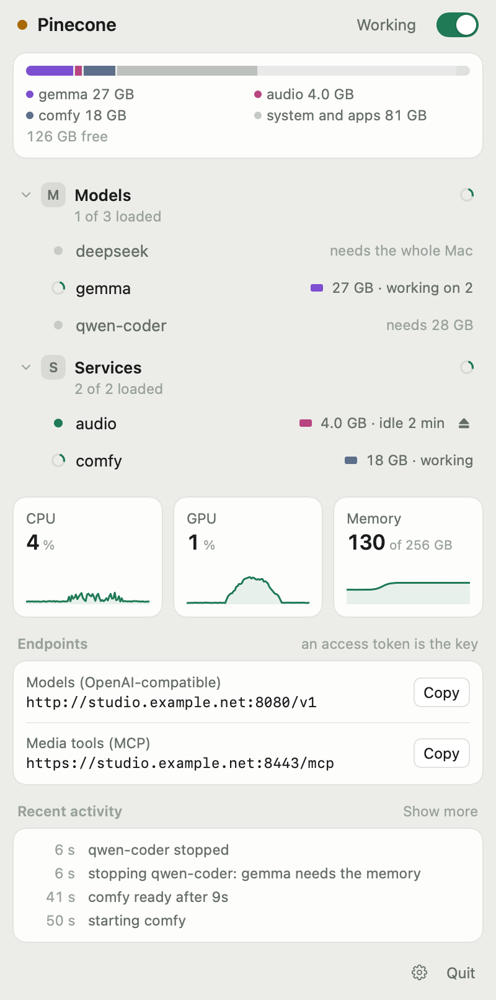
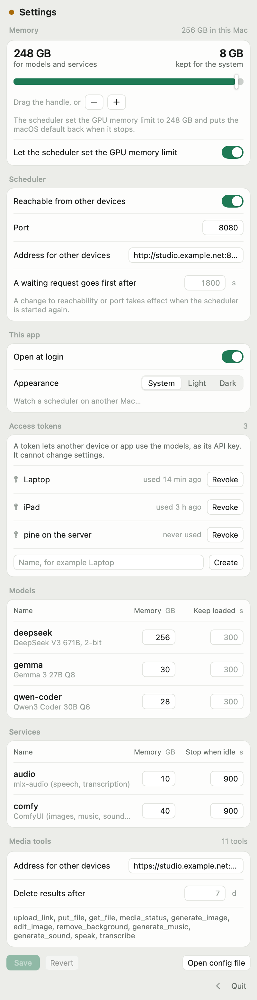

# The menu bar app

[Setup](setup.md) · [Configuration](configuration.md) · [Media tools](tools.md) · [Clients](clients.md) · [API](api.md) · [The app](app.md) · [Operations](operations.md)

Pinecone.app shows what the scheduler is doing and holds the settings that are yours to decide.

  <picture>
    <source media="(prefers-color-scheme: dark)" srcset="images/panel-dark.png">
    
  </picture>
  <picture>
    <source media="(prefers-color-scheme: dark)" srcset="images/settings-dark.png">
    
  </picture>

    menubar/build.sh                                   # needs only the Xcode Command Line Tools
    cp -R menubar/build/Pinecone.app /Applications/

The icon is faded while the scheduler is off and shows a dot while something is loading or working. The
panel lists models and services with their state and memory, a memory bar split by what is loaded, what
is waiting, CPU, GPU and memory graphs, the endpoints to give to clients (with a button to copy each),
and recent activity. A model or service that is loaded and idle has a button to unload it, and a mistake
in `config.json` is shown at the top. The switch at the top starts and stops the background services
installed by `launchd/install.sh`.

Models and services are two lists, each under a line that folds it away with a click, as pine's side bar
has an agent and its conversations. A model or service that is loading, unloading or answering a request
shows a ring that goes round, and so does the line of its list, so work is seen when the list is folded.
One that did not start shows a "!" and says why. What a name stands for (its `title` in the config) shows
when the pointer rests on it. What is folded is kept in the app's preferences on this Mac.

The panel looks like pine's desktop app: cards on the window, neutral surfaces and one green. Light and dark
follow the system, and dark is the poimandres theme. Settings, This app, "Appearance" keeps it light or
dark whatever the system is set to. The choice is the app's own, kept in its preferences on this Mac and
not in `config.json`. The colours are in `Theme`, at the top of `App.swift`.

Settings hold what is the user's to decide on this Mac: the memory split and whether the scheduler sets the
GPU memory limit, whether and where other devices reach it and on which port, how long a request waits
before it goes first, access tokens, for each model and service its planned memory and how long it stays
loaded, and for the media tools their address for other devices and after how many days results are
deleted. It also lists the tools, with any that were left out and why, and has "Open at login" and "Appearance". Save sends
what changed to the scheduler, which writes it into `config.json` and applies it; reachability and port
take effect when the scheduler is started again, the media address when the media server is. What sets a model or a tool up (start commands, paths, ports, model
files, the tools themselves) is not in Settings: that is edited in the file, by you or by an AI agent.

The app keeps no list of models. Everything it shows comes from `/scheduler/status`. Pointed at a
scheduler on another Mac (Settings, This app, "Watch a scheduler on another Mac…"), it asks for an access
token and shows status only; unloading an idle model still works.

`Pinecone --snapshot out.png [--settings] [--dark]` draws the panel into a picture and quits, for checking
design changes without clicking through the app. It needs a running scheduler to have something to show.
`Pinecone --icon out.png` draws the three states of the menu bar icon.
